# Analytics report

*Generated by `python -m analysis.run_all` (from `webapp/backend`). Every number below is read from `analysis/out/*.json`; rerun to reproduce. Context and decisions: `FINDINGS.md`.*

**Data.** The benchmark is the canonical dataset (`data/backfill/sample_plant.csv`): 30 days of real ERA5 weather at 18°N 80°E through the plant's physics model, 4 inverters, injected and labelled faults. Detection results pool seeds 1–8 (same weather, different noise and faults), test window = last 30% of hours, daylight only. The forecast study uses 12 months of real weather at the test plant.

## 1. The data

| Rows | Inverters | Hours | Daylight | Faulted daylight hours | Missing values |
|---|---|---|---|---|---|
| 2,880 | 4 | 720 | 46% | 9.8% | 0 |

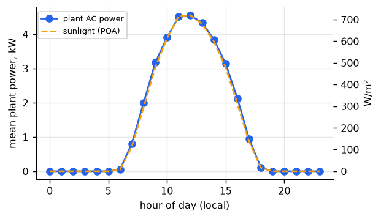 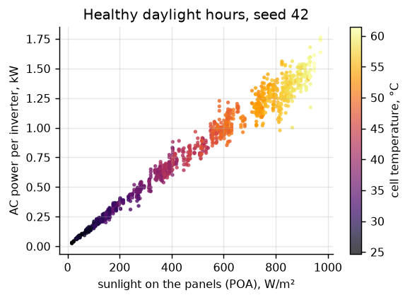

- Output tracks sunlight on the panels almost linearly; the spread at a given irradiance is temperature (hotter = lower), noise, shading and faults.
- **The temperature effect, recovered from the data:** a regression of efficiency on cell temperature over 800 bright, healthy hours gives **-0.41%/°C**, against the -0.38%/°C the simulator was configured with. The difference is sampling noise, not bias: the day-block bootstrap 95% CI is -0.50 to -0.33%/°C (it contains the true value), and across seeds 1–8 the estimate averages -0.40%/°C. The method works; one month of one plant pins the coefficient down to about ±0.1%/°C.

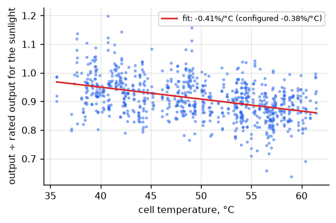 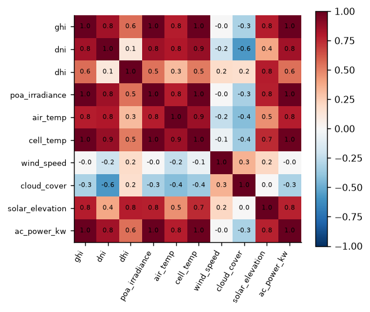

- **Caveat from the correlations:** cell temperature correlates ~1.0 with irradiance because the simulator derives it from irradiance (NOCT model); on a real plant they'd separate more.

## 2. Inside the expected-power model (Random Forest)

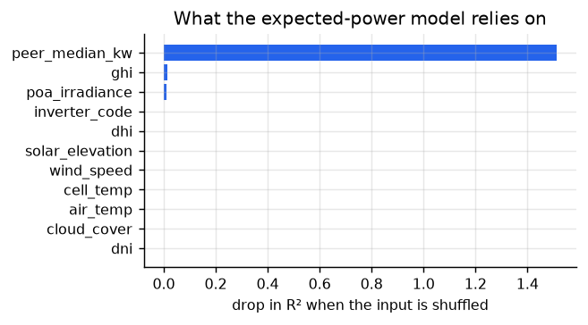 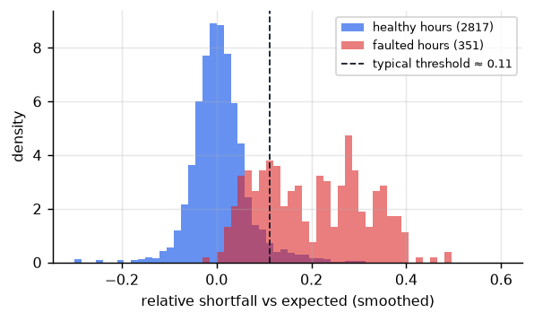

- **It relies almost entirely on the neighbouring inverters.** Shuffling `peer_median_kw` drops R² by 1.51; every weather input by less than 0.015. With the peers known, weather adds little. That's why a plain peer comparison scores as well (FINDINGS §5), and why plant-wide faults (every inverter down together) are its blind spot.
- Healthy hours' relative shortfall: median 0.002, 95th percentile 0.101. Faulted hours: median 0.207. The label-free threshold (~0.11) sits just above the healthy 95th percentile; the overlap below it is where mild faults are missed.

## 3. How sure are the model rankings?

95% confidence intervals from a **day-block bootstrap** (72 seed-days resampled 2,000 times; hours within a day are correlated, so whole days are resampled).

| Model | F1 (pooled) | 95% CI | RF − model | 95% CI of the difference | Wilcoxon p (8 seeds) |
|---|---|---|---|---|---|
| Random Forest | **0.699** | 0.624–0.767 | — | — | — |
| Gradient Boosting | 0.672 | 0.586–0.745 | +0.028 | -0.008 to +0.070 | 0.078 |
| Physics baseline | 0.635 | 0.565–0.696 | +0.065 | +0.007 to +0.124 ✓ | 0.148 |
| Isolation Forest | 0.627 | 0.533–0.707 | +0.072 | +0.005 to +0.146 ✓ | 0.109 |

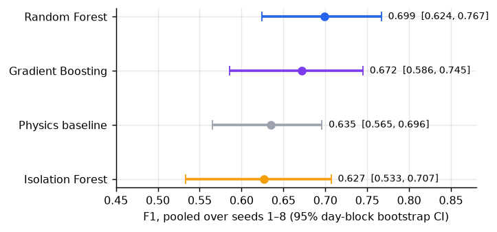

- **Random Forest beats the physics baseline and Isolation Forest** (the bootstrap CI of the difference excludes 0, marked ✓). **It does not significantly beat Gradient Boosting**: the CI crosses 0.
- The per-seed Wilcoxon test finds nothing significant at 5%. With 8 seeds its smallest possible p-value is 0.008 and it ignores how many hours each seed holds, so it's underpowered here; the day-block bootstrap uses the hours and is the better test. More seeds would settle RF vs GB.

## 4. Episodes, not hours

An owner cares whether a fault was *noticed*, not what share of its hours were flagged. Over the 96 fault episodes in the pooled test windows:

| Model | Episodes caught | Alarm runs | False alarm runs | Episode precision | Caught within 1 h |
|---|---|---|---|---|---|
| Random Forest | 65/96 (68%) | 98 | 34 | 65% | 97% |
| Gradient Boosting | 58/96 (60%) | 79 | 22 | 72% | 95% |
| Physics baseline | 81/96 (84%) | 252 | 165 | 34% | 89% |
| Isolation Forest | 53/96 (55%) | 89 | 37 | 58% | 92% |

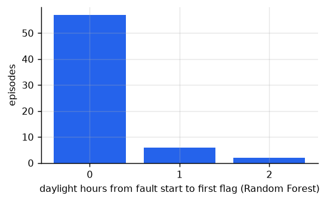

- **Per-hour F1 hid a trade-off.** The physics baseline notices the most episodes (84%) but 165 of its 252 alarms are false (66%). Random Forest notices 68% with 65% of alarms real: fewer catches, far fewer wild-goose chases.
- Caught faults are flagged almost immediately (median 0 daylight hours). That's partly the *centred* smoothing in the retrospective analysis, which looks one hour ahead; the live verdict uses a trailing window and is slower (FINDINGS §2).

## 5. The detection limit, and how it depends on the simulator

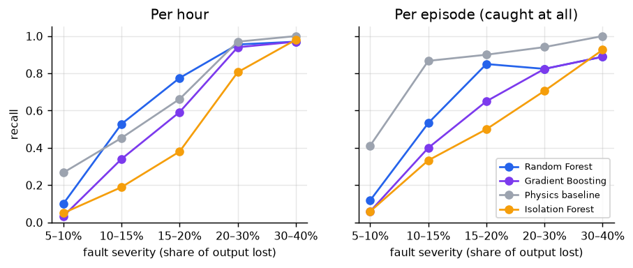

| Severity | 5–10% | 10–15% | 15–20% | 20–30% | 30–40% |
|---|---|---|---|---|---|
| Faulted hours (pooled) | 60 | 53 | 71 | 67 | 100 |
| Random Forest, hourly recall | 10% | 53% | 78% | 96% | 97% |
| Gradient Boosting, hourly recall | 3% | 34% | 59% | 94% | 97% |
| Physics baseline, hourly recall | 27% | 45% | 66% | 97% | 100% |
| Isolation Forest, hourly recall | 5% | 19% | 38% | 81% | 98% |

- **The limit, as a curve:** Random Forest catches 10% of hours with 5–10% losses, 53% at 10–15%, and 96%+ above 20%.

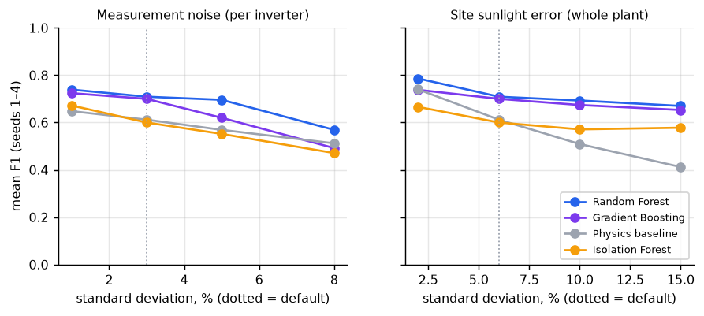

| Measurement noise | 1% | 3% | 5% | 8% |
|---|---|---|---|---|
| Random Forest | 0.739 | 0.709 | 0.696 | 0.569 |
| Gradient Boosting | 0.724 | 0.700 | 0.620 | 0.492 |
| Physics baseline | 0.648 | 0.612 | 0.569 | 0.512 |
| Isolation Forest | 0.672 | 0.600 | 0.552 | 0.471 |

| Site sunlight error | 2% | 6% | 10% | 15% |
|---|---|---|---|---|
| Random Forest | 0.786 | 0.709 | 0.693 | 0.670 |
| Gradient Boosting | 0.738 | 0.700 | 0.674 | 0.653 |
| Physics baseline | 0.740 | 0.612 | 0.509 | 0.412 |
| Isolation Forest | 0.666 | 0.600 | 0.571 | 0.578 |

- **Sky error is what separates the methods.** As the plant-wide gap between reported and real sunlight grows from 2% to 15%, the physics baseline falls from 0.74 to 0.41 F1, while Random Forest only goes 0.79 → 0.67: comparing with neighbouring inverters cancels an error they all share. With an on-site irradiance sensor (little sky error) the simple baseline would be competitive.
- **Measurement noise hurts every method.** From 1% to 8% noise, Random Forest drops 0.74 → 0.57 and stays on top.
- So the headline F1 numbers are properties of the simulator's settings as much as of the models; the *ranking* is robust to measurement noise but depends on how much the reported weather can be trusted.

## 6. Is the forecast any good?

334 days (2025-11-06 to 2026-10-05) at the test plant, daily energy. *Actual* = the plant's physics on ERA5 reanalysis weather; *forecast* = the same physics on the forecast as issued the day before. Skill = 1 − MAE / MAE of the reference.

| | Forecast MAE | Forecast error | Persistence MAE | Climatology MAE | Skill vs persistence | Skill vs climatology |
|---|---|---|---|---|---|---|
| Whole year | 1.54 kWh | 4.6% | 2.65 kWh | 3.72 kWh | **42%** | 59% |
| Monsoon (Jun–Sep, 122 d) | 2.77 kWh | 8.9% | 4.20 kWh | 5.38 kWh | **34%** | 48% |
| Rest of year | 0.83 kWh | 2.2% | 1.76 kWh | 2.76 kWh | **53%** | 70% |

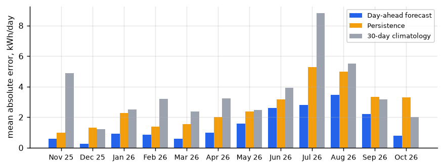
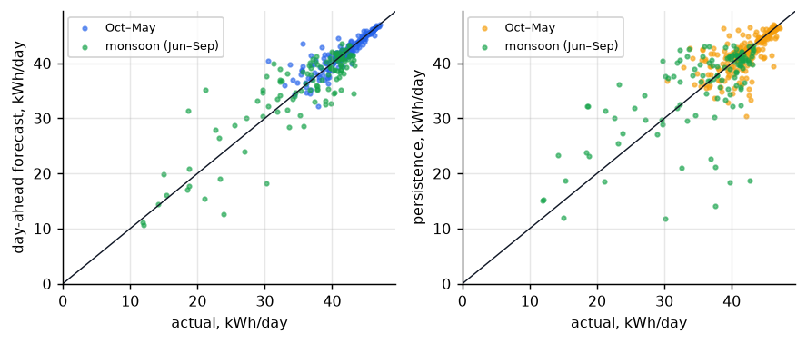

- The day-ahead forecast beats both naive references in every month: overall its error is 42% lower than "tomorrow = today".
- The monsoon is the hard part: the error roughly triples (0.83 → 2.77 kWh/day), but the forecast keeps its lead.
- *Caveat:* "actual" comes from ERA5 reanalysis, not a pyranometer on site, and both sides use the same physics, so this measures the *weather forecast's* skill for this plant, not model error.

## 7. Limitations

- Inverter output is simulated (real weather, physics, injected faults), so detection numbers describe this simulator; section 5 shows how they move with its settings.
- All 8 benchmark seeds share one month of weather at one site; seasons and climates are untested for detection (the forecast study covers a full year at one site).
- Model settings were chosen on the same seeds they're scored on (FINDINGS §1), a mild optimism.

